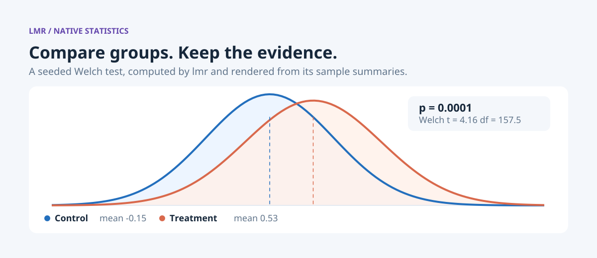
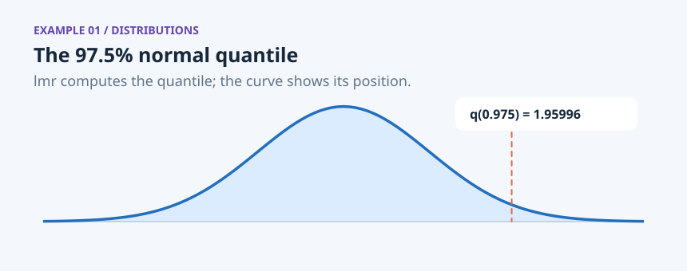
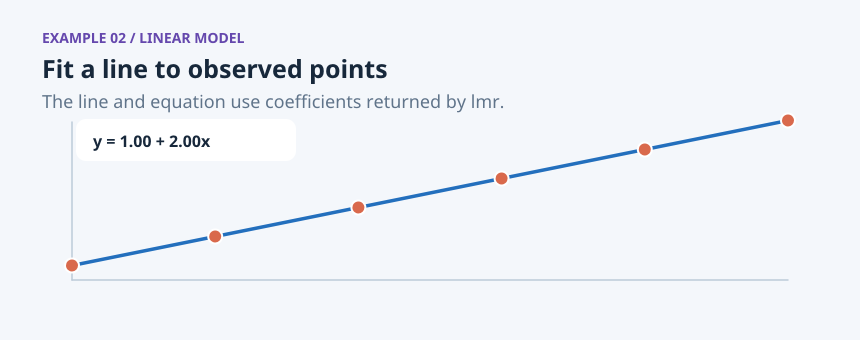
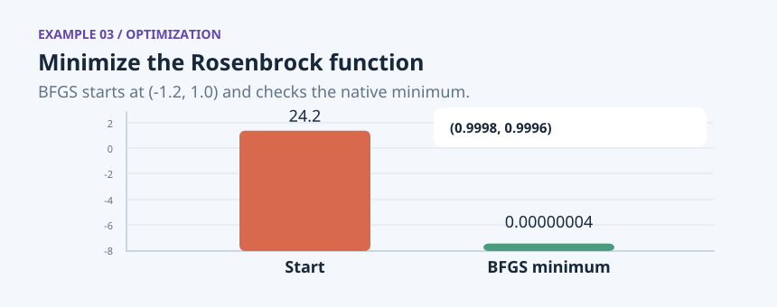
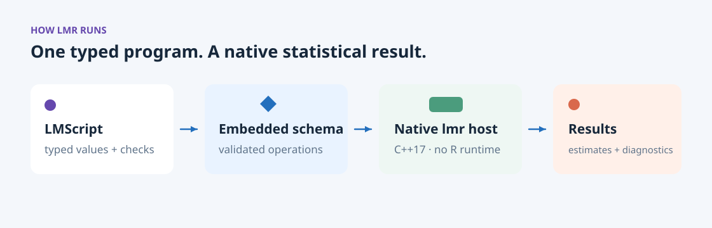

<p align="center">
  <picture>
    <source media="(prefers-color-scheme: dark)" srcset="docs/readme/hero-dark.png">
    <source media="(prefers-color-scheme: light)" srcset="docs/readme/hero-light.png">
    
  </picture>
</p>

**lmr is a native statistics host for LMScript.** It runs distributions, tests, regression, time series, clustering and optimization in a small C++17 executable, with no R runtime.

[](https://github.com/lmctl-ai/lmr/releases)
[](https://github.com/lmctl-ai/lmr/actions/workflows/native.yml)

## Examples

### Normal quantile



lmr computes the quantile and checks the textbook value. [Source](examples/normal-quantile.lms) · [Example book](https://lmctl.com/tools/lmr/examples/normal-quantile.html)

### Linear fit



The displayed line uses coefficients returned by lmr. [Source](examples/linear-fit.lms) · [Example book](https://lmctl.com/tools/lmr/examples/linear-fit.html)

### Rosenbrock minimum



The vertical axis is log10 of the objective; lmr checks the minimum and convergence. [Source](examples/rosenbrock-minimum.lms) · [Example book](https://lmctl.com/tools/lmr/examples/rosenbrock-minimum.html)

## How it works

The diagram is rendered by lmdraw. LMScript compiles against lmr's embedded schema; the native host runs typed statistical operations and returns estimates and diagnostics.



The implementation in `native/` uses a clean-room C++17 statistics core. It needs no R, Docker, Python or third-party runtime libraries. Objectives and models are written in the DSL and checked by the host.

## Quick start

```sh
npm install -g @lmctl-ai/lmctl
lmctl init
lmctl autorun https://lmctl.com/tools/lmr/lmr_solo.lms
```

## Learn and download

- [lmr book](https://lmctl.com/tools/lmr/) · [get started](https://lmctl.com/tools/lmr/get_started.html) · [API guide](https://lmctl.com/tools/lmr/guide.html)
- [LMScript examples](examples/dsl/README.md) · [R comparison recipes](examples/r-vs-dsl/README.md) · [LMScript DSL guide](https://lmctl.com/tools/lmscript/skill.html)
- [Releases and binaries](https://github.com/lmctl-ai/lmr/releases) · [Source](https://github.com/lmctl-ai/lmr)

## Build and test

Requires CMake, Ninja, a C++17 compiler, and Node.js with the published LMScript compiler.

```sh
cmake -S native -B build-native -G Ninja
cmake --build build-native
(cd build-native && ctest)
```

Regenerate the README illustrations and gallery with `docs/readme/render.sh`. The `.lms` sources are in `docs/readme/`; they compute each example's values with the released lmr host and draw the figures with `lmdraw`. If GitHub rate-limits release lookup, set `GITHUB_TOKEN` for the render command.

## License and company

MIT license; see [LICENSE](LICENSE). Made by **Lattice Systems LLC**.
